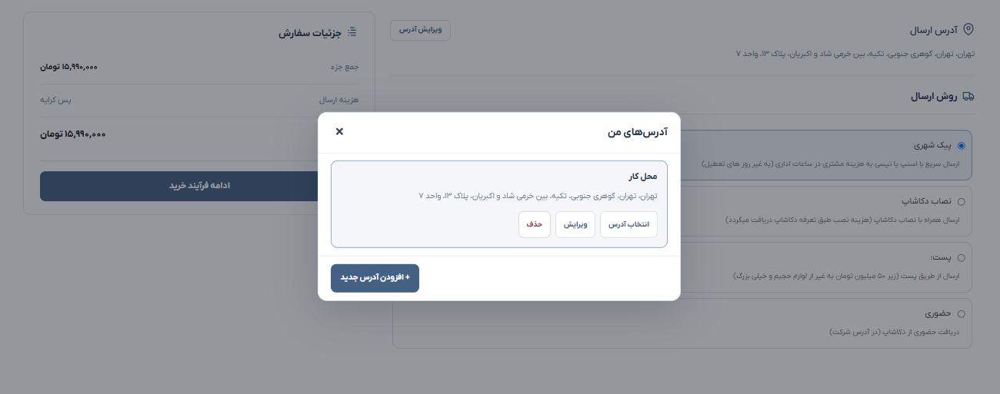
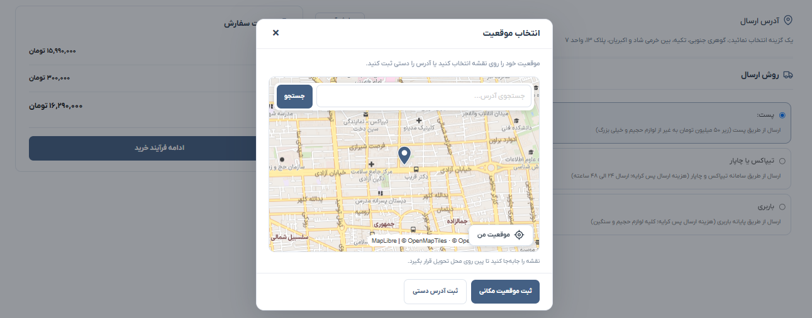
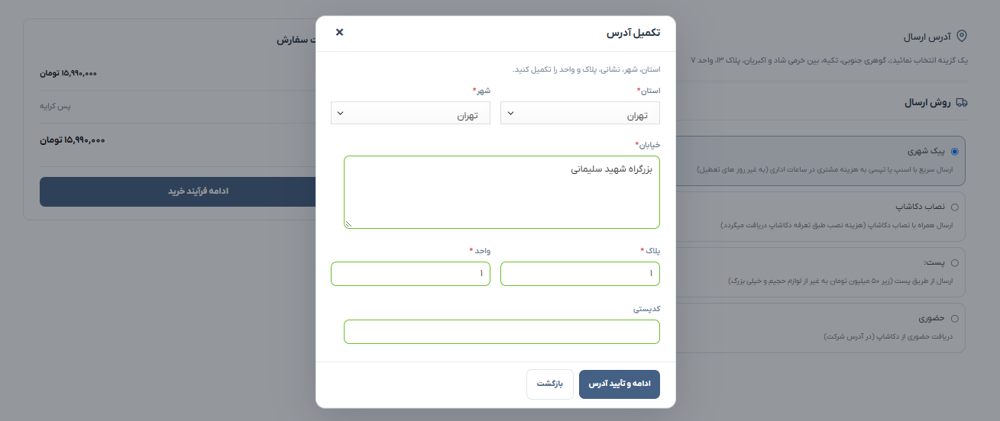
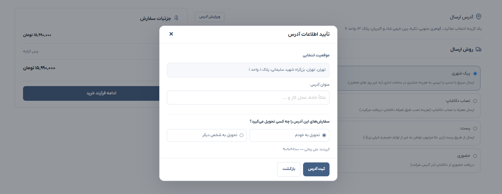
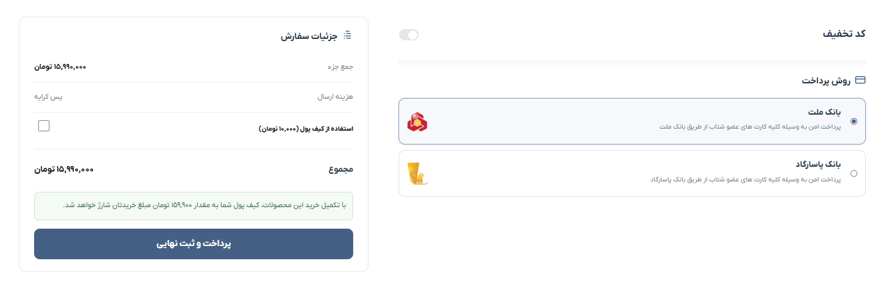

# 🛒 DcaShop Two-Step Checkout for WooCommerce

A custom **two-step checkout plugin for classic WooCommerce**, developed by **Seyyed Behzad Mousaviyan**. It separates address and shipping selection from payment while keeping the existing WooCommerce checkout and order-processing workflow.

**Version:** `v1.0.0` · **First public release**

---

## 📌 Overview

**Dcashop Two-Step Checkout** gives the standard WooCommerce checkout a more structured, responsive, and RTL-friendly customer experience. Customers select or add an address, choose a shipping method, and continue to a dedicated payment step.

This plugin is built around the **classic WooCommerce checkout**, rather than the Checkout Block. It was developed for a specific store setup and should be tested before being used with other themes or checkout extensions.

## ✨ Features

- 🧭 **Two-Step Checkout** — Separate Shipping / Address and Payment steps.
- 🔗 **Dedicated Step URLs** — Supports routes such as `/checkout/shipping/` and `/checkout/payment/` when `checkout` is the checkout page slug.
- 🏠 **Saved Addresses** — Store up to five addresses (including the default), with selection, adding, editing, and deletion.
- 📍 **Map-Based Location Selection** — Uses the separate **Dcashop Uttamap** integration to select a delivery location.
- 📝 **Address Details** — Province, city, street address, plaque, unit, postal code, and saved map coordinates.
- 👤 **Delivery Recipient** — Confirm who will receive the order and manage recipient details.
- 🚚 **WooCommerce Shipping** — Keeps the store's configured shipping methods and shipping calculations.
- 💳 **WooCommerce Payments** — Uses existing WooCommerce payment gateways and checkout processing.
- 🎟️ **Coupons & Wallet** — Supports the checkout's existing coupon and wallet integrations where configured.
- 📱 **Responsive RTL Interface** — Designed for Persian-language storefronts on desktop and mobile.
- ⚙️ **Preview Controls** — Choose **Off**, **Admin preview**, or **Enabled for everyone**.
- 🔄 **Backward Compatibility** — Preserves existing WooCommerce and checkout address metadata keys.

## 🔄 How It Works

1. **Shipping:** The customer checks their delivery address and chooses a shipping method.
2. **Manage Address:** The customer selects an existing saved address or adds a new one.
3. **Pick a Location:** The customer selects the address location on the map, or proceeds with manual address entry where appropriate.
4. **Complete Details:** The customer confirms address fields and delivery-recipient information.
5. **Payment:** The customer reviews the order and completes payment using an available WooCommerce gateway.

## 📸 Screenshots

### 🚚 1. Shipping & Address Step
The first checkout step displays the selected delivery address, available shipping methods, and the order summary.


### 🏠 2. Saved Address Management
Customers can select, edit, delete, or add saved delivery addresses.



### 📍 3. Map Location Picker
The location dialog lets customers choose a delivery location on the map.



### 📝 4. Complete Address Details
Customers complete province, city, street, plaque, unit, and postal-code fields.



### ✅ 5. Address & Recipient Confirmation
The confirmation dialog shows the selected location, an optional address label, and the delivery-recipient choice.



### 💳 6. Payment Step
The second checkout step includes the order summary, coupon area, wallet integration, and available payment gateways.



### ⚙️ 7. Plugin Settings
Administrators can disable the custom checkout, enable an admin-only preview, or enable it for everyone.


## 🧩 Requirements & Integrations

- **WordPress** with **WooCommerce**.
- **Classic checkout page / shortcode**, not the WooCommerce Checkout Block.
- **PHP 7.4+** as declared in the plugin header; compatibility should be verified on the target server.
- **Flatsome** theme layout and **YITH Checkout Manager** fields were part of the original deployment setup.
- **DCAShop Uttamap** is used for map-based address selection. It is a **separate plugin** and is not included in this repository.
- In the original checkout setup, `billing_address_4` stores the plaque number and `billing_address_3` stores the unit number.

## 🚀 Installation

1. Back up the WordPress database and website files before changing an active checkout.
2. Activate WooCommerce and configure a **classic WooCommerce checkout** page.
3. Configure **DCAShop Uttamap** when map-based address selection is needed.
4. Download the **WordPress release ZIP** from the repository's [Releases](https://github.com/behzad79/dcashop-two-step-checkout/releases) page.
5. In WordPress Admin, go to **Plugins → Add New → Upload Plugin**, select the ZIP file, and activate the plugin.
6. Open the checkout-mode settings and enable **Admin preview** first.
7. Test saving and selecting addresses, shipping totals, coupons, the payment hand-off, payment retry, and order confirmation with the store's own gateways.
8. When step URLs return 404, visit **Settings → Permalinks** and click **Save Changes** to refresh rewrite rules.

> **Testing note:** The version label was updated for this public release. A live end-to-end production payment test was not part of the release preparation.

## 🗺️ Address & Map Behavior

- Stores existing map coordinates through `billing_map_lat_long` and compatible address metadata.
- Uses the Uttamap `street` field for automatic street-address population; postal codes are **not** automatically generated by this field.
- Allows manual completion when an address is not provided by the map.
- Preserves existing address data keys for backward compatibility.

## 📂 Project Structure

```text
dcashop-two-step-checkout/
├── assets/
│   ├── account-addresses.css
│   ├── account-addresses.js
│   ├── checkout-steps.css
│   └── checkout-steps.js
├── screenshots/
│   ├── 01-shipping-step.png
│   ├── 02-saved-addresses.png
│   ├── 03-map-location-picker.png
│   ├── 04-address-details-form.png
│   ├── 05-address-confirmation.png
│   ├── 06-payment-step.png
│   └── 07-admin-settings.png
├── dcashop-two-step-checkout.php
├── README.md
└── .gitignore
```

## 👨‍💻 Developer

**Seyyed Behzad Mousaviyan**  
WordPress & WooCommerce Developer  
GitHub: [@behzad79](https://github.com/behzad79)
